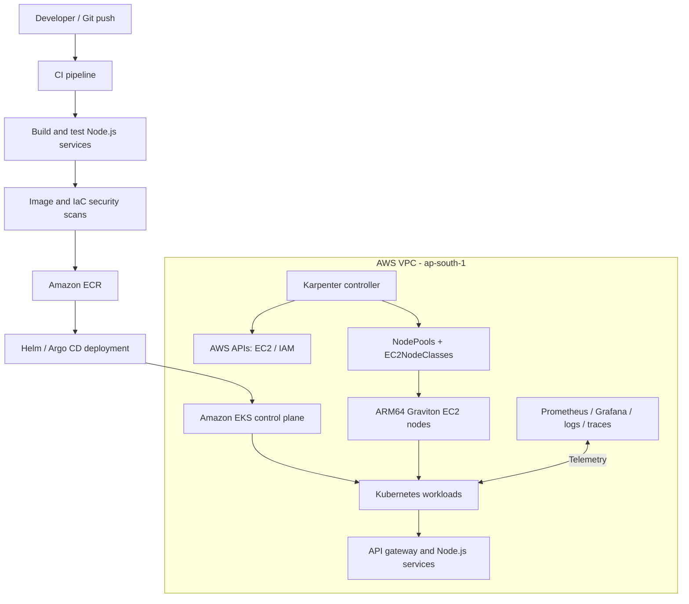

# EKS ARM64 Microservices Platform

[](https://aws.amazon.com/eks/)
[](https://kubernetes.io/)
[](https://www.terraform.io/)
[](https://aws.amazon.com/ec2/graviton/)
[](https://argo-cd.readthedocs.io/)

An infrastructure-as-code and platform-engineering project that provisions an AWS Kubernetes platform for ARM64 Node.js microservices. It combines Amazon EKS, Karpenter, Terraform, container image delivery, GitOps, and observability to demonstrate an end-to-end cloud-native deployment workflow.

> **Environment status:** This repository documents a reproducible platform. The previously used EKS cluster (`eks-arm64-platform`) was deleted during an infrastructure teardown. Treat all deployment commands below as a fresh/rebuild procedure; do not assume AWS resources are currently running. Verify the Terraform configuration and AWS account before applying anything.

---

## Contents

- [Project goals](#project-goals)
- [Architecture](#architecture)
- [Technology stack](#technology-stack)
- [Microservices](#microservices)
- [Repository layout](#repository-layout)
- [Prerequisites](#prerequisites)
- [Configuration](#configuration)
- [Deployment workflow](#deployment-workflow)
- [Karpenter deep dive](#karpenter-deep-dive)
- [Deploy the application](#deploy-the-application)
- [Autoscaling validation](#autoscaling-validation)
- [Operations and troubleshooting runbook](#operations-and-troubleshooting-runbook)
- [Security and production considerations](#security-and-production-considerations)
- [Cost management](#cost-management)
- [Cleanup](#cleanup)
- [Learning outcomes](#learning-outcomes)

## Project goals

1. Provision a repeatable AWS network and EKS platform with Terraform.
2. Run worker workloads on AWS Graviton ARM64 instances where compatible.
3. Use Karpenter to provision and consolidate worker capacity in response to Kubernetes scheduling demand.
4. Build and publish container images for `linux/arm64`.
5. Deploy a Node.js microservices application to Kubernetes.
6. Use Helm and Argo CD patterns for repeatable application delivery.
7. Add metrics, logs, traces, and AWS audit visibility.
8. Practice operational troubleshooting, security controls, and cost-aware infrastructure lifecycle management.

## Architecture



**Scheduling and provisioning flow**

1. A Deployment creates Pods or increases replica count.
2. The Kubernetes scheduler attempts to place Pods on existing nodes.
3. Pods that cannot be scheduled remain `Pending` with resource/constraint events.
4. Karpenter watches those unschedulable Pods and evaluates compatible NodePools.
5. Karpenter calculates required CPU, memory, architecture, zones, capacity type, and other constraints.
6. Karpenter launches a matching EC2 instance through the AWS APIs using the configured EC2NodeClass.
7. The node boots, joins the EKS cluster, and becomes schedulable after its startup requirements are met.
8. The scheduler places the pending Pods. When nodes become underutilized, Karpenter may consolidate workloads and remove unneeded capacity, subject to disruption budgets and Pod constraints.

## Technology stack

| Area | Technology |
|---|---|
| Cloud | AWS, region `ap-south-1` |
| Kubernetes | Amazon EKS |
| Compute | AWS Graviton / ARM64 (`linux/arm64`) |
| Infrastructure as Code | Terraform |
| Node autoscaling | Karpenter, NodePools, EC2NodeClasses |
| Containers | Docker, Docker Buildx, Amazon ECR |
| Application | Node.js microservices |
| API edge | Kong/API gateway (confirm the active chart/config before deployment) |
| Packaging / delivery | Helm, Argo CD, CI pipeline |
| Observability | Prometheus, Grafana, Loki, Tempo; CloudWatch where configured |
| Security | IAM, EKS access controls, Trivy, GitHub OIDC, CloudTrail where configured |

> Versions, chart values, IAM role names, and resource limits should be taken from the checked-in Terraform, Helm, and Kubernetes manifests. Do not copy a version from this overview as a substitute for pinning and reviewing the actual configuration.

## Microservices

The application workspace has included these Node.js services:

| Service | Responsibility | Example local port |
|---|---|---:|
| `api-gateway` | External/API entry point and routing | 3101 |
| `auth-service` | Authentication and identity endpoints | 3102 |
| `employee-service` | Employee domain APIs | 3103 |
| `product-service` | Product domain APIs | 3104 |
| `order-service` | Order domain APIs | 3105 |

Ports are development defaults observed in the local project workflow; Kubernetes Service ports and container ports must be confirmed from the current manifests. PostgreSQL has also been used for persistence in the lab. Never assume a database, PVC, or data backup exists after teardown.

## Repository layout

The repository has evolved during implementation. The following is a logical guide; use `find` to inspect the exact checked-in paths and do not assume every optional directory exists.

```text
.
├── terraform/                 # VPC, EKS, IAM, cluster and platform infrastructure
├── services/                  # Node.js microservices workspaces
│   ├── api-gateway/
│   ├── auth-service/
│   ├── employee-service/
│   ├── product-service/
│   └── order-service/
├── charts/ or helm/            # Helm charts (path depends on current branch)
├── k8s/                        # Kubernetes manifests (if maintained separately)
├── .github/workflows/          # CI/CD and security workflows
├── scripts/                    # Operational helper scripts
└── README.md
```

Inspect the real layout:

```bash
pwd
find . -maxdepth 3 -type f | sort | less
find . -maxdepth 4 \( -iname '*karpenter*' -o -iname '*nodepool*' -o -iname '*nodeclass*' \) -print
```

## Prerequisites

- An AWS account with permissions to create the resources defined by Terraform and Karpenter.
- AWS CLI v2 configured for the intended account and region.
- Terraform, `kubectl`, Helm, `eksctl` (if used by the repo), Docker with Buildx, Git, `jq`.
- GitHub repository access and CI secrets/variables configured if using GitHub Actions.
- A Linux shell or WSL Ubuntu environment.

Check tools and identity:

```bash
aws --version
terraform version
kubectl version --client
helm version
docker version
 docker buildx version
aws sts get-caller-identity
aws configure get region
```

Set the expected region and confirm account before any write operation:

```bash
export AWS_REGION=ap-south-1
export AWS_DEFAULT_REGION="$AWS_REGION"
aws sts get-caller-identity --output table
```

## Configuration

1. Review Terraform variables and provider configuration:

   ```bash
   cd terraform
   grep -RInE 'variable |default\s*=|region\s*=|cluster_name|node_group' --include='*.tf' .
   find . -maxdepth 3 -type f \( -name '*.tfvars' -o -name '*.tfvars.example' \) -print
   ```

2. Create a local `terraform.tfvars` only from the repository's documented example. Do not commit credentials, private keys, state files, or unrestricted administrator CIDRs.
3. Set the API access CIDR to your current public IP with `/32` where the configuration requires it. Do not use `0.0.0.0/0` for a management endpoint unless there is a deliberate, reviewed reason.
4. Review backend configuration. If remote state is configured, verify the S3 bucket, key, region, encryption, versioning, and lock mechanism. Do not initialize a new backend over an existing state location without understanding its contents.
5. Check the cluster name and region. The previously used cluster name was `eks-arm64-platform` in `ap-south-1`.

Example public IP lookup (review the result before putting it in a tfvars file):

```bash
curl -s https://checkip.amazonaws.com
```

## Deployment workflow

> Run one stage at a time. Read the plan before applying. These commands can create billable AWS resources.

### 1. Terraform validate and plan

```bash
cd ~/eks-arm64-microservices-platform/terraform
terraform fmt -recursive
terraform init
terraform validate
terraform plan -out=tfplan
terraform show tfplan
```

Confirm the account, region, VPC CIDR, subnet layout, cluster name, node group settings, IAM roles, and estimated capacity. Then apply only after review:

```bash
terraform apply tfplan
```

Record outputs:

```bash
terraform output
terraform output -json > terraform-outputs.json
```

Do not publish `terraform.tfstate`, `terraform.tfstate.backup`, plan files, or outputs containing sensitive values.

### 2. Connect kubectl to EKS

Use the cluster name and region returned by Terraform, not a guessed value:

```bash
aws eks update-kubeconfig --region ap-south-1 --name eks-arm64-platform
kubectl config current-context
kubectl cluster-info
kubectl get nodes -o wide
```

Verify the cluster and nodes before installing Karpenter:

```bash
aws eks describe-cluster --name eks-arm64-platform --region ap-south-1 \
  --query 'cluster.{status:status,version:version,endpoint:endpoint,roleArn:roleArn}'
kubectl get nodes -L kubernetes.io/arch,topology.kubernetes.io/zone,node.kubernetes.io/instance-type
```

### 3. Install platform prerequisites

Install or verify the EKS add-ons and identity mechanism declared in Terraform (for example VPC CNI, CoreDNS, kube-proxy, EBS CSI, and Pod Identity Agent). Avoid installing a second copy of an add-on already managed by Terraform.

```bash
aws eks list-addons --cluster-name eks-arm64-platform --region ap-south-1
kubectl get pods -n kube-system -o wide
kubectl get daemonsets -n kube-system
```

### 4. Install Karpenter

Use the official Karpenter installation guide matching the Kubernetes and Karpenter versions selected for the cluster. The following is a **template**, not a replacement for the repository's pinned chart version, IAM setup, and values file. Fill in the values from Terraform outputs and the checked-in configuration.

```bash
export CLUSTER_NAME=eks-arm64-platform
export AWS_REGION=ap-south-1
export KARPENTER_NAMESPACE=karpenter
export KARPENTER_VERSION='<PINNED_KARPENTER_VERSION>'
export KARPENTER_IAM_ROLE='<KARPENTER_CONTROLLER_ROLE_NAME>'
export INTERRUPTION_QUEUE='<KARPENTER_INTERRUPTION_QUEUE>'

helm upgrade --install karpenter oci://public.ecr.aws/karpenter/karpenter \
  --version "$KARPENTER_VERSION" \
  --namespace "$KARPENTER_NAMESPACE" --create-namespace \
  --set settings.clusterName="$CLUSTER_NAME" \
  --set settings.interruptionQueue="$INTERRUPTION_QUEUE" \
  --set serviceAccount.annotations.eks\.amazonaws\.com/role-arn="arn:aws:iam::$(aws sts get-caller-identity --query Account --output text):role/$KARPENTER_IAM_ROLE"
```

The command above is intentionally parameterized. In production, store values in a reviewed Helm values file and manage installation through the chosen IaC/GitOps workflow. Confirm the exact chart schema for the pinned release. The controller must have the required IAM permissions, cluster endpoint access, and interruption queue configuration.

Validate controller readiness:

```bash
kubectl get deployment -n karpenter
kubectl get pods -n karpenter -o wide
kubectl logs -n karpenter deployment/karpenter --all-containers=true --tail=200
```

### 5. Apply Karpenter NodeClass and NodePools

The project has used ARM64 NodePools named `arm64-graviton` (On-Demand) and `arm64-spot` (Spot), with an EC2NodeClass named `arm64-graviton`. Names and selectors must match the manifests in the branch being deployed.

```bash
# Locate the actual manifests first
find . -type f \( -iname '*nodepool*.yaml' -o -iname '*nodeclass*.yaml' -o -iname '*karpenter*.yaml' \) -print

# Apply the actual manifest paths discovered above
kubectl apply -f <path-to-ec2nodeclass.yaml>
kubectl apply -f <path-to-on-demand-nodepool.yaml>
kubectl apply -f <path-to-spot-nodepool.yaml>
```

Inspect resources:

```bash
kubectl get ec2nodeclass
kubectl describe ec2nodeclass arm64-graviton
kubectl get nodepools
kubectl describe nodepool arm64-graviton
kubectl describe nodepool arm64-spot
```

### 6. Build and publish ARM64 images

All application images and native dependencies must support ARM64. Buildx can produce an ARM64 image from an x86_64 workstation:

```bash
aws ecr get-login-password --region ap-south-1 \
  | docker login --username AWS --password-stdin \
    "$(aws sts get-caller-identity --query Account --output text).dkr.ecr.ap-south-1.amazonaws.com"

# Example for one service; repeat for each service using its correct Dockerfile/context.
docker buildx build --platform linux/arm64 \
  -t <ACCOUNT_ID>.dkr.ecr.ap-south-1.amazonaws.com/<ECR_REPOSITORY>:<TAG> \
  --push <BUILD_CONTEXT>
```

For multi-platform images, use `--platform linux/amd64,linux/arm64` only when every base image and native dependency supports both architectures. Prefer immutable digests for production deployments.

Verify image architecture:

```bash
docker buildx imagetools inspect <IMAGE_URI>:<TAG>
```

### 7. Deploy application workloads

Use the Helm chart or GitOps Application path that exists in the current branch. Example generic commands:

```bash
kubectl create namespace microservices --dry-run=client -o yaml | kubectl apply -f -
helm upgrade --install <RELEASE_NAME> <CHART_PATH> \
  --namespace microservices \
  --values <ENVIRONMENT_VALUES_FILE> \
  --wait --timeout 10m
```

Check rollout and service discovery:

```bash
kubectl get deployments,statefulsets,replicasets,pods,svc -n microservices -o wide
kubectl rollout status deployment/<DEPLOYMENT_NAME> -n microservices --timeout=180s
kubectl get endpoints,endpointslices -n microservices
```

If Argo CD is the deployment controller, commit the desired chart/manifests to Git and sync the corresponding Application. Avoid having Argo CD and a manual Helm release independently manage the same resources.

---

## Karpenter deep dive

### What Karpenter does

Karpenter is a Kubernetes node lifecycle and autoscaling controller. It observes Pods that cannot be scheduled and provisions infrastructure that satisfies their scheduling requirements. Unlike a fixed-size worker group, Karpenter can select from a set of allowed instance families, sizes, zones, architectures, and capacity types. It can also consolidate workloads to reduce idle capacity.

Karpenter does **not** replace the Kubernetes scheduler. Karpenter provisions nodes; Kubernetes schedules Pods onto ready nodes.

### Core resources

| Resource | Purpose | Key settings |
|---|---|---|
| Karpenter controller | Watches scheduling demand and manages EC2 capacity | Cluster name, cluster endpoint, AWS region, IAM identity, interruption queue |
| `EC2NodeClass` | AWS-specific node launch configuration | AMI family/selector, subnet/security-group selectors, instance profile, block devices, metadata options, tags |
| `NodePool` | Defines allowed capacity and scheduling policy | Requirements, limits, weight, labels/taints, disruption policy, `template.spec.nodeClassRef` |
| `NodeClaim` | Represents a node Karpenter intends to provision | Selected instance type, zone, capacity type, lifecycle/conditions |
| Interruption queue | Delivers interruption and rebalance events | SQS queue plus EventBridge rules and IAM permissions |

### NodePool scheduling requirements

A NodePool expresses which EC2 offerings are eligible. Common requirement keys include:

- `kubernetes.io/arch`: `arm64` for Graviton-only workloads.
- `kubernetes.io/os`: `linux`.
- `karpenter.sh/capacity-type`: `on-demand` or `spot`.
- `node.kubernetes.io/instance-type`: optional allow-list.
- `topology.kubernetes.io/zone`: eligible Availability Zones.
- `karpenter.k8s.aws/instance-family`, `instance-category`, `instance-generation`, and `instance-cpu`: AWS instance constraints.

An illustrative ARM64 requirement fragment:

```yaml
requirements:
  - key: kubernetes.io/arch
    operator: In
    values: [arm64]
  - key: kubernetes.io/os
    operator: In
    values: [linux]
  - key: karpenter.sh/capacity-type
    operator: In
    values: [on-demand, spot]
  - key: karpenter.k8s.aws/instance-family
    operator: In
    values: [t4g, c7g, m7g]
```

This fragment is explanatory, not a complete NodePool. For a real configuration, separate Spot and On-Demand pools if they need different weights, limits, or disruption policies. Confirm that every allowed instance type is available in the selected AZs and compatible with the Pod's CPU/memory/architecture needs.

### NodeClass responsibilities

An `EC2NodeClass` selects AWS resources and boot configuration. Review these fields in the actual manifest:

- `amiSelectorTerms`: ensure the AMI family and architecture are compatible. For ARM64, the selected AMI must be ARM64-capable.
- `subnetSelectorTerms`: select private subnets in the intended VPC/AZs.
- `securityGroupSelectorTerms`: select the EKS node security groups required for control-plane and workload connectivity.
- `role` or `instanceProfile`: the node IAM identity must be correctly configured for the chosen Karpenter version and identity setup.
- `blockDeviceMappings`: size and type of root EBS volume; consider ephemeral workload storage.
- `metadataOptions`: require IMDSv2 where compatible with the workload design.
- `tags`: apply ownership, environment, and cost-allocation tags.

Use narrow selectors. Broad selectors can accidentally allow nodes into unrelated subnets or security groups.

### ARM64 / Graviton application requirements

A node being ARM64 does not automatically make a container compatible. Check all layers:

1. The image manifest includes `linux/arm64`.
2. The base image supports ARM64.
3. Native Node.js modules were installed or compiled for ARM64.
4. Build scripts do not download x86_64-only binaries.
5. DaemonSets, sidecars, agents, and observability images support ARM64.
6. Pod scheduling rules do not conflict with the NodePool's architecture labels.

Inspect a running node and its Pods:

```bash
kubectl get nodes -L kubernetes.io/arch,node.kubernetes.io/instance-type
kubectl get pods -A -o wide
kubectl describe pod <POD> -n <NAMESPACE>
```

For workloads that must run only on ARM64, add a node selector or node affinity:

```yaml
spec:
  template:
    spec:
      nodeSelector:
        kubernetes.io/arch: arm64
```

Use this only if the workload image is known to support ARM64. A hard selector on a workload with no compatible NodePool will leave it Pending.

### Spot versus On-Demand

| Capacity | Advantages | Trade-offs | Good fit |
|---|---|---|---|
| On-Demand | Predictable capacity, no Spot interruption | Higher unit price | Critical services, stateful workloads, baseline capacity |
| Spot | Potentially lower compute cost | Can be interrupted; availability varies | Stateless replicas, batch, fault-tolerant services |

Design for interruption: multiple replicas, PodDisruptionBudgets where appropriate, graceful termination, readiness probes, externalized state, and a suitable fallback On-Demand pool. A PDB can also block consolidation if it prevents safe eviction; investigate blocked disruptions rather than removing safeguards blindly.

### Resource limits and disruption

Set NodePool CPU/memory limits to cap aggregate provisioned capacity. Choose values based on the account's EC2 quotas and budget. A low limit can prevent scaling; an excessively high limit can create unexpected cost exposure.

Karpenter disruption/consolidation settings control when nodes can be replaced or removed. Review:

- consolidation policy and consolidation delay;
- disruption budgets and allowed disruption windows;
- PodDisruptionBudgets and topology spread;
- `do-not-disrupt` annotations (if used);
- workloads with local storage or restrictive affinity;
- node expiration and drift policies.

Do not enable aggressive consolidation for stateful or interruption-sensitive workloads without testing eviction and recovery behavior.

### Karpenter operational commands

```bash
# Controller and logs
kubectl get pods -n karpenter -o wide
kubectl logs -n karpenter deployment/karpenter --all-containers=true --since=30m
kubectl logs -n karpenter deployment/karpenter --all-containers=true -f

# CRDs and policy objects
kubectl get crd | grep -E 'karpenter|nodepool|nodeclaim|ec2nodeclass'
kubectl get nodepools
kubectl get ec2nodeclasses
kubectl get nodeclaims -o wide
kubectl describe nodepool arm64-graviton
kubectl describe nodepool arm64-spot
kubectl describe ec2nodeclass arm64-graviton

# Events and scheduling demand
kubectl get events -A --sort-by=.lastTimestamp | tail -80
kubectl get pods -A --field-selector=status.phase=Pending -o wide
kubectl describe pod <PENDING_POD> -n <NAMESPACE>

# Node lifecycle
kubectl get nodes -o wide
kubectl describe node <NODE_NAME>
kubectl get nodeclaims -o yaml
```

### Karpenter lifecycle model

```text
Pending Pod
   |
   v
Scheduler cannot place Pod
   |
   v
Karpenter evaluates NodePools + Pod constraints
   |
   v
NodeClaim created
   |
   v
EC2 instance launched from EC2NodeClass
   |
   v
Instance joins EKS and node becomes Ready
   |
   v
Kubernetes scheduler binds Pod
   |
   v
Demand falls -> consolidation / disruption policy evaluated
   |
   v
Node drained and terminated when safe
```

---

## Deploy the application

### Build all service images

Use the root workspace scripts if present. First inspect them:

```bash
cat package.json
find services -maxdepth 2 -name Dockerfile -o -name package.json
```

Example service-specific build:

```bash
docker buildx build --platform linux/arm64 \
  -f services/auth-service/Dockerfile \
  -t <ECR_REGISTRY>/<AUTH_REPOSITORY>:<TAG> \
  --push .
```

If a Dockerfile uses a build argument such as `SERVICE`, pass it explicitly and ensure it is declared before use:

```dockerfile
ARG SERVICE
# ...
COPY services/${SERVICE}/src ./src
```

The build command must provide the matching argument, for example `--build-arg SERVICE=auth-service`. Keep the build context at the repository root if the Dockerfile copies from `services/...`.

### Validate image user and runtime

For Kubernetes `runAsNonRoot`, use a numeric UID/GID in the image and in the Pod security context. A named Linux user such as `appuser` can cause runtime validation failures in some container/runtime combinations if the image metadata cannot be resolved as expected.

```bash
docker image inspect <IMAGE> --format '{{.Os}}/{{.Architecture}} user={{.Config.User}}'
```

Example secure Dockerfile pattern:

```dockerfile
RUN addgroup --system --gid 10001 appgroup \
 && adduser --system --uid 10001 --ingroup appgroup appuser
USER 10001:10001
```

Align the image UID/GID with the Pod `securityContext`. Test file permissions for writable paths before enforcing a read-only root filesystem.

---

## Autoscaling validation

### 1. Check current capacity

```bash
kubectl get nodes -o wide
kubectl get nodepools
kubectl get nodeclaims
kubectl get pods -A -o wide
```

### 2. Create a temporary ARM64 scheduling test

Use a small test workload and ensure the NodePool has sufficient limits and eligible capacity. This creates billable compute if Karpenter provisions a node.

```bash
kubectl create namespace karpenter-test --dry-run=client -o yaml | kubectl apply -f -
kubectl run arm64-test -n karpenter-test \
  --image=public.ecr.aws/docker/library/busybox:1.36 \
  --restart=Never \
  --overrides='{"spec":{"nodeSelector":{"kubernetes.io/arch":"arm64"},"containers":[{"name":"arm64-test","image":"public.ecr.aws/docker/library/busybox:1.36","command":["sh","-c","sleep 1800"],"resources":{"requests":{"cpu":"500m","memory":"512Mi"}}}]}}'
```

Observe provisioning:

```bash
kubectl get pod arm64-test -n karpenter-test -w
kubectl get nodeclaims -w
kubectl get nodes -L kubernetes.io/arch,node.kubernetes.io/instance-type -w
```

Validate placement and architecture:

```bash
kubectl get pod arm64-test -n karpenter-test -o wide
kubectl get node "$(kubectl get pod arm64-test -n karpenter-test -o jsonpath='{.spec.nodeName}')" \
  -o jsonpath='{.metadata.labels.kubernetes\.io/arch}{"\n"}'
```

Remove the test workload after validation:

```bash
kubectl delete namespace karpenter-test
```

### 3. Test scale-out with a Deployment

For a repeatable test, create a Deployment with realistic resource requests and increase replicas gradually. Watch pending Pods, NodeClaims, and EC2 launches. Avoid creating excessive replicas in a small-budget account.

```bash
kubectl scale deployment/<DEPLOYMENT_NAME> -n <NAMESPACE> --replicas=3
kubectl get pods -n <NAMESPACE> -w
kubectl get nodeclaims -w
```

### 4. Test scale-in / consolidation

Scale back down and observe whether Karpenter identifies removable nodes:

```bash
kubectl scale deployment/<DEPLOYMENT_NAME> -n <NAMESPACE> --replicas=1
kubectl get nodeclaims -w
kubectl get events -A --sort-by=.lastTimestamp | tail -60
```

Consolidation is asynchronous and policy-dependent. Do not force-delete a NodeClaim or EC2 instance as a shortcut; first understand Pod eviction and disruption conditions.

---

## Operations and troubleshooting runbook

Start with read-only diagnostics. Capture the exact error, namespace, object name, and recent events before changing resources.

### A. Cluster access or authentication failure

```bash
aws sts get-caller-identity
aws eks describe-cluster --name eks-arm64-platform --region ap-south-1
aws eks update-kubeconfig --name eks-arm64-platform --region ap-south-1
kubectl config get-contexts
kubectl config current-context
kubectl cluster-info
kubectl auth can-i get nodes
```

**Common causes:** wrong AWS profile/account/region, deleted cluster, expired or incorrect credentials, missing EKS access entry/RBAC authorization, or wrong kubeconfig context. If `describe-cluster` returns `ResourceNotFoundException`, the cluster does not exist in that account/region; kubeconfig refresh will not recreate it.

### B. Nodes are NotReady or do not join

```bash
kubectl get nodes -o wide
kubectl describe node <NODE_NAME>
kubectl get pods -n kube-system -o wide
kubectl get events -A --sort-by=.lastTimestamp | tail -100
aws ec2 describe-instances --region ap-south-1 \
  --filters Name=tag:eks:cluster-name,Values=eks-arm64-platform \
  --query 'Reservations[].Instances[].[InstanceId,State.Name,InstanceType,PrivateIpAddress,SubnetId]' --output table
```

Check node IAM permissions, security-group rules, private subnet routing, DNS, EKS endpoint reachability, bootstrap/user data, CNI health, and instance architecture. Compare the node's Kubernetes version and AMI compatibility with the control plane.

### C. Pods remain Pending

```bash
kubectl get pods -A --field-selector=status.phase=Pending -o wide
kubectl describe pod <POD> -n <NAMESPACE>
kubectl get events -n <NAMESPACE> --sort-by=.lastTimestamp | tail -60
kubectl get nodepools
kubectl describe nodepool <NODEPOOL>
kubectl get nodeclaims -o wide
kubectl logs -n karpenter deployment/karpenter --since=20m
```

Look for `Insufficient cpu`, `Insufficient memory`, untolerated taints, node selector/affinity conflicts, unavailable AZ offerings, NodePool limits, incompatible architecture, PVC topology constraints, or no matching NodePool. Pod requests—not observed utilization—drive scheduling and bin-packing decisions.

### D. Karpenter does not create a node

```bash
kubectl get pods -n karpenter -o wide
kubectl describe deployment karpenter -n karpenter
kubectl logs -n karpenter deployment/karpenter --all-containers=true --since=30m
kubectl get nodepools -o yaml
kubectl get ec2nodeclasses -o yaml
kubectl get nodeclaims -o yaml
kubectl get events -A --sort-by=.lastTimestamp | grep -iE 'karpenter|nodeclaim|provision|failed|error' | tail -100
```

Check, in order:

1. Controller Pod is Running and Ready.
2. Controller has the intended IAM role (IRSA or EKS Pod Identity, consistent with the deployment).
3. IAM policies allow required EC2, pricing, SSM, EKS, and tagging operations for the selected Karpenter release.
4. The NodeClass is Ready and resolves valid subnets, security groups, AMIs, and instance profile/role.
5. The NodePool references the correct NodeClass API group/kind/name.
6. NodePool requirements match Pod architecture, OS, zones, taints, and capacity type.
7. NodePool limits have not been reached.
8. EC2 quotas, account restrictions, instance offerings, and Spot capacity allow launch.
9. Controller can reach the Kubernetes API and AWS APIs.

### E. NodeClass or NodePool is not Ready

```bash
kubectl get ec2nodeclass
kubectl describe ec2nodeclass <NODECLASS_NAME>
kubectl get nodepool
kubectl describe nodepool <NODEPOOL_NAME>
kubectl get crd | grep -E 'nodepools|ec2nodeclasses'
```

A missing CRD usually means the Karpenter CRDs/chart were not installed or versions are mismatched. Check the API version in each manifest against the installed CRD and pinned Karpenter release. Inspect NodeClass status conditions for unresolved selectors or IAM/AMI issues.

### F. Spot capacity unavailable

Inspect NodeClaim/controller events and AWS offerings. Broaden compatible instance families and/or AZs only after confirming the workload supports them. Maintain an On-Demand fallback for critical workloads.

```bash
aws ec2 describe-instance-type-offerings --region ap-south-1 \
  --location-type availability-zone \
  --filters Name=instance-type,Values=t4g.small,t4g.medium,c7g.large,m7g.large \
  --query 'InstanceTypeOfferings[].[InstanceType,Location]' --output table
```

Spot capacity is dynamic; a successful check does not guarantee capacity at launch time. Review account Spot limits and service-linked role status as well.

### G. ImagePullBackOff / ErrImagePull

```bash
kubectl describe pod <POD> -n <NAMESPACE>
kubectl get events -n <NAMESPACE> --sort-by=.lastTimestamp | tail -60
aws ecr describe-repositories --region ap-south-1
aws ecr describe-images --repository-name <REPOSITORY> --region ap-south-1
```

Check image URI/tag/digest, repository existence, ECR authorization, node network access to ECR/S3, image pull secrets if applicable, and whether the image manifest supports ARM64. Prefer immutable tags/digests over mutable `latest`.

### H. `exec format error` or wrong architecture

```bash
kubectl get nodes -L kubernetes.io/arch,node.kubernetes.io/instance-type
kubectl describe pod <POD> -n <NAMESPACE>
docker buildx imagetools inspect <IMAGE_URI>:<TAG>
docker image inspect <LOCAL_IMAGE> --format '{{.Os}}/{{.Architecture}}'
```

Build/publish a `linux/arm64` image and verify every base image and native dependency. Do not schedule an AMD64-only image on an ARM64 node.

### I. `runAsNonRoot` / named-user image failure

Symptoms can include messages similar to `container has runAsNonRoot and image has non-numeric user`. Inspect the image's configured user and Pod security context:

```bash
docker image inspect <IMAGE_URI>:<TAG> --format '{{.Config.User}}'
kubectl get pod <POD> -n <NAMESPACE> -o yaml
kubectl describe pod <POD> -n <NAMESPACE>
```

Use a numeric non-root UID/GID in the image (`USER 10001:10001`) and align `runAsUser`, `runAsGroup`, and `fsGroup` as needed. Rebuild and push a new immutable image tag, update the Deployment/Helm values, and restart the rollout:

```bash
kubectl set image deployment/<DEPLOYMENT> <CONTAINER>=<NEW_IMAGE_URI> -n <NAMESPACE>
kubectl rollout status deployment/<DEPLOYMENT> -n <NAMESPACE>
kubectl rollout history deployment/<DEPLOYMENT> -n <NAMESPACE>
```

### J. CrashLoopBackOff

```bash
kubectl get pods -n <NAMESPACE> -o wide
kubectl describe pod <POD> -n <NAMESPACE>
kubectl logs <POD> -n <NAMESPACE> --all-containers=true --tail=200
kubectl logs <POD> -n <NAMESPACE> --all-containers=true --previous --tail=200
kubectl get events -n <NAMESPACE> --sort-by=.lastTimestamp | tail -80
```

Check application startup command, environment variables, secrets/config maps, probes, permissions, memory limits, dependency reachability, and database migrations. `--previous` only works when a previous container instance exists; some runtime or permission errors can prevent log retrieval.

### K. Service has no endpoints / API returns 5xx

```bash
kubectl get svc,endpoints,endpointslices -n <NAMESPACE>
kubectl get pods -n <NAMESPACE> --show-labels
kubectl describe svc <SERVICE> -n <NAMESPACE>
kubectl port-forward svc/<SERVICE> 8080:<SERVICE_PORT> -n <NAMESPACE>
curl -i http://127.0.0.1:8080/health
```

Confirm Service selectors match Pod labels, targetPort matches the container's listening port, readiness probes pass, and NetworkPolicies/security controls allow traffic. Test service-to-service DNS from a temporary debug Pod if needed.

### L. PVC Pending / EBS volume attach problems

```bash
kubectl get pvc,pv -A
kubectl describe pvc <PVC> -n <NAMESPACE>
kubectl get pods -n kube-system | grep -i ebs
kubectl logs -n kube-system deployment/ebs-csi-controller --all-containers=true --tail=150
kubectl get events -A --sort-by=.lastTimestamp | grep -iE 'volume|attach|mount|ebs' | tail -80
aws ec2 describe-volumes --region ap-south-1 --output table
```

Check EBS CSI add-on health and IAM permissions, StorageClass provisioner, AZ topology, volume attachment limits, encryption/KMS permissions, and whether the volume is already attached elsewhere. Stateful data must be backed up before any PVC/PV/volume deletion.

### M. Karpenter will not consolidate or delete a node

```bash
kubectl get nodeclaims -o wide
kubectl describe node <NODE_NAME>
kubectl get pdb -A
kubectl get pods -A -o wide --field-selector spec.nodeName=<NODE_NAME>
kubectl get events -A --sort-by=.lastTimestamp | tail -100
kubectl logs -n karpenter deployment/karpenter --since=30m
```

Look for PDB blocks, non-evictable Pods, local storage, topology constraints, disruption budgets, `do-not-disrupt` annotations, or insufficient replacement capacity. Do not bypass disruption protections without understanding service impact.

### N. Terraform errors / stuck destroy

```bash
cd terraform
terraform state list
terraform plan
terraform output
aws sts get-caller-identity
```

For AWS dependency errors, inspect the exact resource before retrying:

```bash
aws ec2 describe-network-interfaces --region ap-south-1 \
  --filters Name=vpc-id,Values=<VPC_ID> --output table
aws ec2 describe-instances --region ap-south-1 \
  --filters Name=vpc-id,Values=<VPC_ID> --output table
aws ec2 describe-nat-gateways --region ap-south-1 \
  --filter Name=vpc-id,Values=<VPC_ID> --output table
aws elbv2 describe-load-balancers --region ap-south-1 --output table
```

Delete dependent resources in dependency order only after confirming ownership. Do not manually delete resources still managed by Terraform unless you intentionally reconcile state afterward. Never use `terraform state rm` as a way to make a failed destroy appear successful.

### O. Useful one-shot diagnostic bundle

```bash
#!/usr/bin/env bash
set -u
NS="${1:-microservices}"
echo '=== AWS identity ==='
aws sts get-caller-identity
echo '=== EKS cluster ==='
aws eks describe-cluster --name eks-arm64-platform --region ap-south-1 \
  --query 'cluster.{status:status,version:version}' 2>&1 || true
echo '=== Nodes ==='
kubectl get nodes -o wide 2>&1 || true
echo '=== Karpenter ==='
kubectl get pods -n karpenter -o wide 2>&1 || true
kubectl get nodepools,ec2nodeclasses,nodeclaims 2>&1 || true
echo '=== Application namespace ==='
kubectl get all,pvc,events -n "$NS" --sort-by=.metadata.creationTimestamp 2>&1 || true
echo '=== Recent cluster events ==='
kubectl get events -A --sort-by=.lastTimestamp 2>&1 | tail -100
```

Save as `scripts/diagnose-cluster.sh`, make executable with `chmod +x scripts/diagnose-cluster.sh`, then run `./scripts/diagnose-cluster.sh microservices`. The script is diagnostic only; it does not repair or delete resources.

---

## Security and production considerations

- Use least-privilege IAM roles for Terraform, Karpenter, nodes, CI, and workloads. Avoid long-lived IAM user keys in CI; prefer GitHub OIDC.
- Separate controller permissions from node instance permissions.
- Restrict EKS API access and use EKS access entries/RBAC deliberately.
- Keep Kubernetes secrets out of Git. Use an approved secret manager integration.
- Pin Terraform providers, Helm chart versions, container base images, and deployment image digests.
- Scan source, IaC, and images; review findings rather than blindly suppressing them.
- Run containers as non-root, drop unnecessary Linux capabilities, and define resource requests/limits and health probes.
- Use private subnets for worker nodes where possible and restrict security-group ingress/egress.
- Enable CloudTrail and appropriate audit/retention controls. Validate log retention and storage costs.
- Use multiple replicas and disruption-aware configuration for critical services.
- Test restore procedures for databases and persistent volumes. A Kubernetes manifest is not a backup.

## Cost management

Karpenter can improve utilization but does not make compute free. The main cost drivers are EC2 instances, EBS volumes/snapshots, NAT gateways, load balancers, data transfer, ECR storage, CloudWatch logs/metrics, and control-plane/other managed services.

Before a lab session:

```bash
aws sts get-caller-identity
aws eks list-clusters --region ap-south-1
aws ec2 describe-instances --region ap-south-1 \
  --filters Name=instance-state-name,Values=pending,running,stopping,stopped \
  --query 'Reservations[].Instances[].[InstanceId,State.Name,InstanceType,Tags[?Key==`Project`].Value|[0]]' --output table
aws ec2 describe-volumes --region ap-south-1 \
  --query 'Volumes[?State!=`deleted`].[VolumeId,State,Size,Attachments[0].InstanceId]' --output table
aws ec2 describe-nat-gateways --region ap-south-1 \
  --query 'NatGateways[?State!=`deleted`].[NatGatewayId,State,VpcId]' --output table
```

Use small, workload-appropriate instance allow-lists and NodePool limits. Spot is suitable only for interruption-tolerant workloads. Configure budgets and billing alerts in AWS. Check every region in which resources may have been created; this README's commands default to `ap-south-1`.

## Cleanup

Cleanup is destructive. Back up application data and Terraform state first. Confirm the AWS account, region, resource tags, and dependency graph. The following is a high-level order, not a blind deletion script:

1. Stop incoming traffic and scale down stateless application workloads.
2. Back up databases and persistent data if they must be retained. If data deletion is intended, explicitly verify that decision.
3. Remove GitOps Applications/Helm releases and application namespaces, taking care not to delete shared platform components accidentally.
4. Remove Karpenter NodePools and allow Karpenter to drain/terminate managed nodes safely; then remove NodeClasses and controller resources according to the installed release's uninstall guidance.
5. Remove remaining managed node groups and EKS add-ons as managed by Terraform.
6. Destroy EKS and dependent infrastructure through Terraform where possible.
7. Resolve remaining ENIs, load balancers, NAT gateways, EIPs, route-table associations, and subnet dependencies before deleting the VPC.
8. Delete ECR repositories, snapshots, log groups, and other retained resources only when no longer required.
9. Run a read-only inventory across relevant AWS regions and review billing/cost explorer after cleanup.

Do not delete default VPC resources or resources belonging to another project. Do not remove IAM service-linked roles simply because they remain after the cluster is gone; AWS may use them for other services.

## Learning outcomes

This project is designed to demonstrate practical skills in:

- Terraform modules, state, plans, dependency graphs, and infrastructure lifecycle.
- EKS networking, cluster access, add-ons, node groups, and Kubernetes operations.
- Karpenter architecture, ARM64 constraints, NodePools, EC2NodeClasses, NodeClaims, Spot/On-Demand, and consolidation.
- Multi-architecture container builds and image registry workflows.
- Kubernetes Deployments, Services, probes, security contexts, storage, and scheduling.
- Helm, GitOps, CI/CD, image scanning, IAM/OIDC, and operational troubleshooting.
- Metrics/logging/tracing and AWS cost/security awareness.

## References

- [Amazon EKS documentation](https://docs.aws.amazon.com/eks/latest/userguide/what-is-eks.html)
- [Karpenter documentation](https://karpenter.sh/docs/)
- [Karpenter AWS provider documentation](https://karpenter.sh/docs/concepts/nodepools/)
- [AWS Graviton](https://aws.amazon.com/ec2/graviton/)
- [Terraform AWS Provider](https://registry.terraform.io/providers/hashicorp/aws/latest/docs)
- [Kubernetes documentation](https://kubernetes.io/docs/)
- [Helm documentation](https://helm.sh/docs/)
- [Argo CD documentation](https://argo-cd.readthedocs.io/)

---

## Author

**Ashish Mondal** · [GitHub](https://github.com/Ashish420-tech)

*Cloud-native platform engineering lab focused on AWS, Kubernetes, ARM64/Graviton, Karpenter, Terraform, and DevOps automation.*
