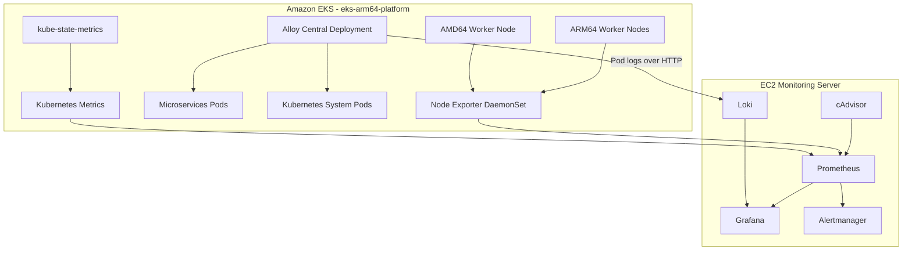

# Centralized EKS Observability Platform

## 1. Overview

This branch introduces centralized monitoring and log collection for the **EKS ARM64 Microservices Platform**.

The observability stack runs on a dedicated EC2 management server and collects metrics and application logs from the existing Amazon EKS cluster.

The implementation uses:

- Prometheus — metrics collection and monitoring
- Grafana — dashboards and visualization
- Loki — centralized log storage
- Grafana Alloy — Kubernetes pod log collection
- Alertmanager — alert routing
- cAdvisor — container metrics for the EC2 Docker host
- Kubernetes Node Exporter — node-level metrics
- kube-state-metrics — Kubernetes object and workload metrics

**Important:** This branch adds the observability configuration and exported Alloy resources. It does not recreate the EKS cluster or replace the existing application deployment.

---

## 2. Architecture



### Data collection flow

**Metrics**

1. Node Exporter exposes node-level metrics from EKS worker nodes.
2. kube-state-metrics exposes Kubernetes resource and workload metrics.
3. Prometheus scrapes the configured endpoints.
4. Grafana queries Prometheus to visualize metrics.
5. Alertmanager receives alerts generated by Prometheus.

**Logs**

1. Alloy discovers Kubernetes pods.
2. Alloy reads container logs using Kubernetes pod discovery and log access.
3. Alloy attaches Kubernetes metadata and static cluster labels.
4. Alloy forwards logs to Loki.
5. Grafana queries Loki for log exploration and dashboards.

---

## 3. Infrastructure

### AWS environment

| Component | Configuration |
|---|---|
| AWS Region | ap-south-1 |
| EKS Cluster | eks-arm64-platform |
| Kubernetes Version | 1.36 |
| VPC CIDR | 10.0.0.0/16 |
| Monitoring EC2 Private IP | 10.0.11.218 |
| Monitoring EC2 Public IP | 43.204.11.89 |
| Monitoring EC2 Instance | m7i-flex.large |
| Monitoring OS | Ubuntu 24.04 |
| Monitoring deployment path | /opt/monitoring |
| Repository observability path | observability/ |

### Network communication

| Source | Destination | Port | Purpose |
|---|---|---:|---|
| EKS worker nodes | Monitoring EC2 | 3100/TCP | Loki log ingestion |
| Monitoring EC2 | EKS worker nodes | 9100/TCP | Node Exporter scraping |
| Monitoring EC2 | EKS worker nodes | 30080/TCP | kube-state-metrics scraping |
| Administrator | Monitoring EC2 | 3000/TCP | Grafana UI |

Restrict inbound security group rules to trusted sources and the required EKS security group. Do not expose Loki or Prometheus publicly.

---

## 4. Repository Structure

```text
observability/
├── README.md
├── docker-compose.yml
│
├── prometheus/
│   ├── prometheus.yml
│   └── rules/
│       └── alerts.yml
│
├── alertmanager/
│   └── alertmanager.yml
│
├── loki/
│   ├── docker-compose.yml
│   └── config/
│       └── loki.yml
│
├── grafana/
│
├── alloy/
│   ├── alloy-central-config.yaml
│   ├── alloy-central-deployment.yaml
│   ├── alloy-serviceaccount.yaml
│   ├── alloy-clusterrole.yaml
│   └── alloy-clusterrolebinding.yaml
│
└── manifests/
```

The Alloy YAML files are exported Kubernetes resources from the running cluster. The `grafana/` and `manifests/` directories are reserved for future provisioning and additional Kubernetes monitoring manifests.

Runtime databases, persistent metric data, Loki data, and credentials are deliberately excluded from Git.

---

## 5. Component Details

### 5.1 Prometheus

Prometheus collects and stores time-series metrics.

Configuration:

`prometheus/prometheus.yml`

Current scrape targets include:

- Prometheus itself
- Three EKS worker-node Node Exporter endpoints
- kube-state-metrics at the configured NodePort

Prometheus configuration:

- Container: `monitoring-prometheus`
- Port: `9090`
- Retention: 7 days
- Lifecycle reload enabled
- Configuration mounted read-only

Useful queries:

```promql
up
```

```promql
node_uname_info
```

```promql
kube_node_info
```

```promql
kube_pod_info
```

Check targets:

```text
http://localhost:9090/targets
```

### 5.2 Grafana

Grafana provides dashboards and visual exploration.

- Container: `monitoring-grafana`
- Port: `3000`
- Persistent data: `grafana/data`
- Signup disabled
- Prometheus and Loki are used as data sources

Dashboards already imported:

| Dashboard | ID |
|---|---:|
| Node Exporter Full | 1860 |
| Kube-State-Metrics Overview | 25091 |
| Prometheus Overview | 3662 |

Grafana URL:

```text
http://43.204.11.89:3000
```

Use the credentials configured through the server-side `.env` file. Never commit that file.

### 5.3 Loki

Loki is the centralized log storage system.

Configuration:

`loki/config/loki.yml`

- Container: `monitoring-loki`
- Version observed: 3.5.7
- Port: `3100`
- Data retention: 72 hours
- Storage: filesystem
- Schema: v13
- Data directory: `/opt/monitoring/loki/data`

Health check:

```bash
curl http://10.0.11.218:3100/ready
```

Expected response:

```text
ready
```

Example LogQL queries:

All cluster logs:

```logql
{cluster="eks-arm64-platform"}
```

Microservices logs:

```logql
{namespace="microservices"}
```

Individual service logs:

```logql
{namespace="microservices", container="api-gateway"}
```

### 5.4 Grafana Alloy

Alloy collects Kubernetes container logs and forwards them to Loki.

Deployment:

- Namespace: `observability`
- Deployment: `alloy-central`
- Replica count: 1
- Image: `grafana/alloy:v1.21.3`
- Node architecture: AMD64
- Service account: `alloy`
- Loki destination: `http://10.0.11.218:3100/loki/api/v1/push`

The central Deployment was selected instead of a full Alloy DaemonSet to reduce memory consumption on the relatively small EKS worker nodes.

Static labels include:

```text
cluster=eks-arm64-platform
environment=production
```

Kubernetes metadata includes namespace, pod, container, application, job, and node labels.

Check the Deployment:

```bash
kubectl get deployment alloy-central -n observability
```

Check its pods:

```bash
kubectl get pods -n observability -o wide
```

Inspect logs:

```bash
kubectl logs deployment/alloy-central -n observability
```

### 5.5 Alertmanager

Configuration:

`alertmanager/alertmanager.yml`

- Container: `monitoring-alertmanager`
- Port: `9093`
- Configuration mounted read-only
- Persistent notification state under `alertmanager/data`

The current configuration has a default receiver. An external notification integration still needs to be configured before production alert notifications can be considered complete.

### 5.6 cAdvisor

The Docker Compose configuration includes cAdvisor.

It exposes container metrics for the **monitoring EC2 Docker host**. It should not be treated as complete EKS container monitoring.

EKS container metrics require an appropriate Kubernetes-side collection strategy.

---

## 6. Deployment and Operations

### Prerequisites

- Existing EKS cluster and worker nodes
- EC2 monitoring server
- AWS CLI and configured AWS credentials
- kubectl configured for the existing EKS cluster
- Docker Engine and Docker Compose
- Required network access between EKS and EC2

### Start the monitoring stack

On the EC2 monitoring server:

```bash
cd /opt/monitoring
sudo docker compose up -d
```

Check containers:

```bash
sudo docker compose ps
```

Check logs:

```bash
sudo docker compose logs --tail=100
```

### Start Loki

```bash
cd /opt/monitoring/loki
sudo docker compose up -d
```

Check Loki:

```bash
sudo docker logs monitoring-loki --tail=100
```

### Validate Prometheus

```bash
sudo docker exec monitoring-prometheus \
  promtool check config /etc/prometheus/prometheus.yml
```

Check scrape targets:

```bash
curl -s http://127.0.0.1:9090/api/v1/targets
```

### Validate Alloy

```bash
kubectl get deployment alloy-central -n observability
kubectl get pods -n observability
kubectl logs deployment/alloy-central -n observability --tail=100
```

### Validate Loki ingestion

```bash
curl -G -s \
  --data-urlencode 'query={namespace="microservices"}' \
  --data-urlencode 'limit=10' \
  http://10.0.11.218:3100/loki/api/v1/query_range
```

### Check node metrics

```bash
kubectl top nodes
```

```bash
kubectl get nodes -o wide
```

---

## 7. Troubleshooting

### Prometheus target is DOWN

Check:

```bash
curl -s http://127.0.0.1:9090/api/v1/targets
```

Validate:

- Target IP and port
- Node Exporter availability
- kube-state-metrics Service and NodePort
- EC2 security group inbound rules
- EKS node security group rules
- Prometheus scrape configuration

### Alloy cannot send logs to Loki

Check Alloy:

```bash
kubectl logs deployment/alloy-central -n observability --tail=100
```

Test Loki from an EKS pod:

```bash
kubectl run loki-connectivity-test \
  --image=curlimages/curl \
  --restart=Never \
  --command -- sh -c \
  'curl -sS -m 10 -w "\nHTTP %{http_code}\n" http://10.0.11.218:3100/ready'
```

Check the pod:

```bash
kubectl get pod loki-connectivity-test
```

Clean up:

```bash
kubectl delete pod loki-connectivity-test
```

Verify:

- Loki is ready.
- EC2 security group allows TCP 3100 from the EKS worker-node security group.
- Loki is listening on the EC2 private interface.
- Alloy configuration contains the correct Loki push endpoint.

### Grafana cannot connect to Loki

Use the Loki service endpoint reachable from Grafana's Docker network.

For the current shared Docker network configuration:

```text
http://monitoring-loki:3100
```

Check Docker network membership:

```bash
sudo docker network inspect monitoring_monitoring
```

Check Loki:

```bash
curl http://10.0.11.218:3100/ready
```

### Grafana login problem

Do not store passwords in Git.

The Grafana administrator password is managed through the EC2 server's protected environment configuration. Rotate credentials if they are exposed.

---

## 8. Security and Production Considerations

- Never commit `.env`, passwords, API tokens, access keys, or webhook URLs.
- Keep Prometheus and Alertmanager bound to localhost unless a secured access path is required.
- Restrict Grafana access to trusted administrator IP addresses.
- Keep Loki private within the VPC.
- Restrict EKS-to-EC2 communication using security group references.
- Use IAM roles and least-privilege Kubernetes RBAC.
- Avoid exposing Kubernetes metrics endpoints to the public internet.
- Pin container image versions instead of relying on `latest` for production deployments.
- Back up Grafana, Prometheus, and Loki persistent data.
- Monitor available EC2 disk space and storage growth.
- Review retention settings against the available disk capacity.

---

## 9. Current Implementation Status

| Component | Status |
|---|---|
| Prometheus on EC2 | Implemented |
| Grafana on EC2 | Implemented |
| Loki on EC2 | Implemented |
| Alloy central Deployment | Implemented |
| Kubernetes pod log collection | Verified |
| Node Exporter | Implemented |
| kube-state-metrics | Implemented |
| Prometheus scrape targets | Verified UP |
| Grafana dashboards | Initial dashboards imported |
| Alertmanager | Deployed; notification integration pending |
| cAdvisor | Included in Compose; EC2 host metrics |
| Karpenter metrics | Pending |
| EKS container-level metrics | Further integration required |
| Tempo distributed tracing | Pending |
| OpenTelemetry integration | Pending |
| Grafana dashboard provisioning | Pending |

---

## 10. Roadmap

1. Complete Grafana dashboards for EKS and Loki.
2. Integrate Karpenter controller metrics into Prometheus.
3. Complete Kubernetes container-level monitoring.
4. Configure Prometheus alert rules and Alertmanager notifications.
5. Deploy Tempo for distributed tracing.
6. Instrument Apollo Router and Node.js microservices with OpenTelemetry.
7. Implement centralized trace, metric, and log correlation.
8. Add production-grade security, retention, and backup policies.

---

## 11. Repository

**GitHub:** https://github.com/Ashish420-tech/eks-arm64-microservices-platform

**Branch:** `feature/observability-monitoring`

**Commit:** `feat: add centralized EKS observability stack`

This branch contains the centralized observability configuration and Alloy Kubernetes resource exports for the existing EKS platform.

